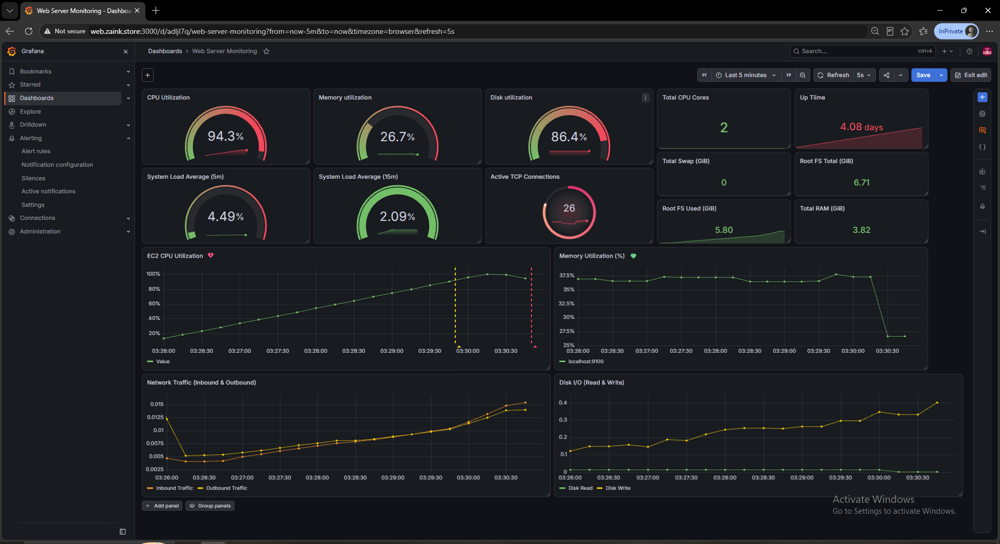
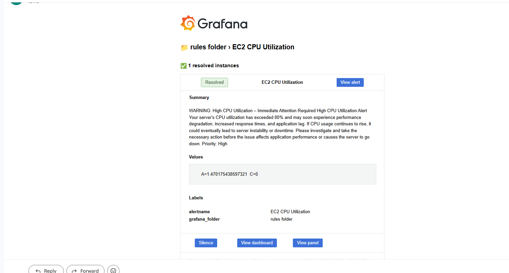
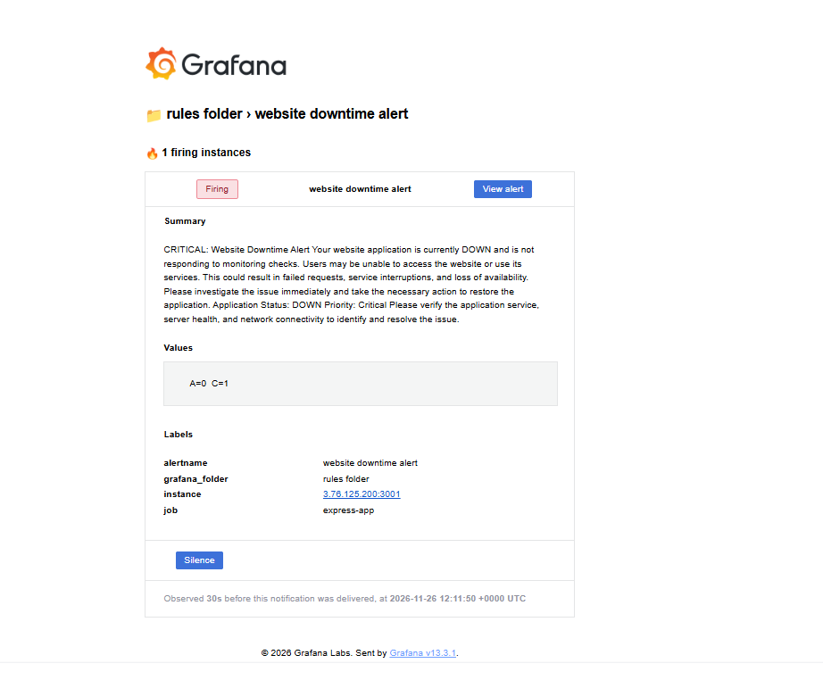

## Project Overview

An automated AWS monitoring setup built with **Terraform** to keep an eye on server health and website uptime in real time using **Prometheus and Grafana**.

### How It Works

* **Infrastructure as Code:** Spun up an AWS EC2 server with Terraform and opened the essential ports (`22` for SSH, `80` for web traffic, `3000` for Grafana, `3001` for the web app, `9090` for Prometheus, and `9100` for Node Exporter).
* **Fast Scripted Setup:** Automated the installation of Prometheus, Node Exporter, and Grafana using shell scripts so the monitoring stack spins up quickly without manual guesswork.
* **Live Visibility:** Node Exporter pulls raw server stats (CPU, memory, disk), Prometheus collects and stores those metrics, and Grafana turns them into clear visual dashboards—helping spot slowdowns before users feel them.
* **Custom Domain:** Pointed `web.zaink.store` to the EC2 public IP using **Amazon Route 53** for easy access.

## Website Features

### Domain Inspector

A simple web tool hosted on the server that lets anyone check key details for a domain in seconds:

* **IP Addresses**
* **Nameservers**
* **Mail Servers (MX)**
* **DNS Records**

## Screenshots

 

---

 

## Grafana Monitoring

Built two dedicated Grafana dashboards to separate low-level server health from live website performance—making it easy to spot where a problem starts.

### 1. Web Server Monitoring Dashboard

Watches the EC2 machine's hardware limits, storage, and network flow in real time.

#### What It Tracks

* **System Specs & Load:** Total CPU cores, total RAM and swap space, server uptime, active network connections, and 5- / 15-minute system load averages.
* **Live Usage Gauges:** Real-time percentages for CPU, memory, and root disk usage (used vs. total space).
* **Performance Trends:** Live graphs tracking CPU spikes, memory consumption, inbound/outbound network traffic, and disk read/write speeds.

#### Automated Email Alerts

Set up automatic Grafana alerts to warn of heavy server strain before things crash:

* **High Memory:** Sends an email alert if memory usage stays above **70%** for more than **1 minute**.
* **High CPU:** Sends an email alert if CPU usage stays above **90%** for more than **1 minute**.

 

---

 
### 2. Website Application Monitoring Dashboard

Keeps a real-time pulse on website uptime, traffic flow, API speed, and backend health so slowdowns get caught fast.

#### What It Tracks

* **App Health & Speed:** Live status (UP/DOWN), total uptime, requests per second, success vs. error rates, and response speeds (average and slowest 5%).
* **Web Traffic:** Breakdown of incoming requests (`GET`, `POST`, `PUT`, `DELETE`, `HEAD`), response status codes (`200`, `404`, etc.), and busiest API routes.
* **Node.js Backend:** CPU load, memory and heap usage, and event loop delays to make sure the server stays responsive under traffic.

#### Automated Email Alerts

Set up instant email alerts in Grafana to catch problems before users complain:

* **Site Outage:** Fires an email if the website goes down for more than **1 minute**.
* **Slow Responses:** Fires an email if response times climb past **500ms** for more than **1 minute**.

 

---

 

## Future Improvements

- **HTTPS Security:** Add an Nginx reverse proxy with Let's Encrypt SSL certificates for encrypted traffic.
- **Slack / Discord Alerts:** Route Grafana alert notifications to a messaging channel alongside email for faster incident response.
- **Containerized Stack:** Package Prometheus, Grafana, and the web app into Docker Compose for easier portability.