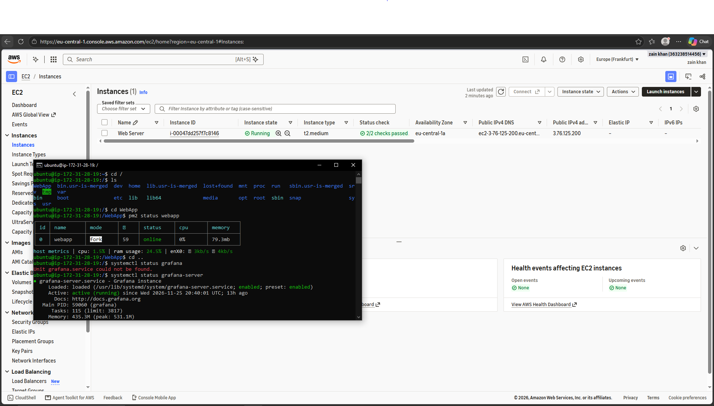
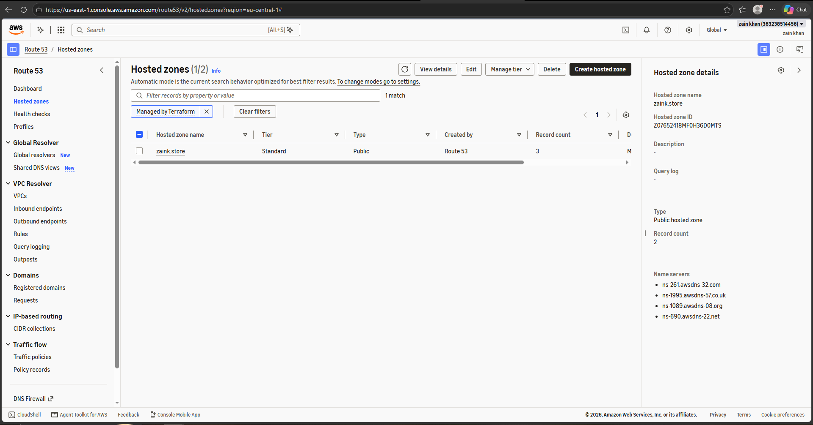
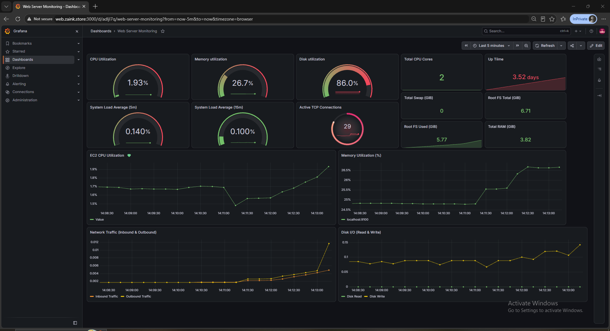

## Project Overview

An automated AWS monitoring setup built with **Terraform** to keep an eye on server health and website uptime in real time using **Prometheus and Grafana**.

### How It Works

* **Infrastructure as Code:** Spun up an AWS EC2 server with Terraform and opened the essential ports (`22` for SSH, `80` for web traffic, `3000` for Grafana, `3001` for the web app, `9090` for Prometheus, and `9100` for Node Exporter).
* **Fast Scripted Setup:** Automated the installation of Prometheus, Node Exporter, and Grafana using shell scripts so the monitoring stack spins up quickly without manual guesswork.
* **Live Visibility:** Node Exporter pulls raw server stats (CPU, memory, disk), Prometheus collects and stores those metrics, and Grafana turns them into clear visual dashboards—helping spot slowdowns before users feel them.
* **Custom Domain:** Pointed `web.zaink.store` to the EC2 public IP using **Amazon Route 53** for easy access.

## Website Features

### Domain Inspector

A simple web tool hosted on the server that lets anyone check key details for a domain in seconds:

* **IP Addresses**
* **Nameservers**
* **Mail Servers (MX)**
* **DNS Records**

## Screenshots

## Grafana Monitoring

Created two separate Grafana dashboards to monitor EC2 server health and website application performance.

### 1. Web Server Monitoring Dashboard

Monitors EC2 server health, resource utilization, and network activity.

**Server Monitoring Stats (Gauges)**

- CPU Utilization
- Memory Utilization
- Disk Utilization
- System Load Average (5-minute and 15-minute)
- Active TCP Connections
- Total CPU Cores
- Server Uptime
- Total Swap Memory (GiB)
- Root Filesystem Total Size (GiB)
- Root Filesystem Used Space (GiB)
- Total RAM (GiB)

**Server Monitoring Graphs**

- EC2 CPU Utilization
- Memory Utilization
- Network Traffic (Inbound and Outbound)
- Disk I/O (Read and Write)

**Alert Rules**

Configured automatic email alerts in Grafana for the following conditions:

- **High Memory Usage:** Sends an email alert if memory utilization exceeds 90% for more than 1 minute.
- **High CPU Usage:** Sends an email alert if CPU utilization exceeds 90% for more than 1 minute.

These alerts help identify high resource usage before it causes server performance issues or downtime.

### 2. Website Application Monitoring Dashboard

Monitors website availability, HTTP traffic, API performance, response times, and Node.js runtime metrics.

**Application Monitoring Stats**

- Application Status (UP/DOWN)
- Average Response Time
- Success Rate
- Error Rate
- P95 Response Time
- Requests per Second
- Application Uptime

**HTTP Traffic Monitoring**

- HTTP Traffic by Method (GET, POST, PUT, DELETE, HEAD)
- Response Time Percentiles (P50, P95, P99)
- Requests by HTTP Method
- HTTP Responses by Status Code (200, 404, etc.)
- Top Endpoints and Request Counts

**Node.js Runtime Monitoring**

- CPU Usage
- Memory Usage
- Event Loop Lag
- Heap Usage
- Application Uptime

This dashboard helps track website health, identify slow API responses, monitor HTTP errors, and detect application performance issues.

