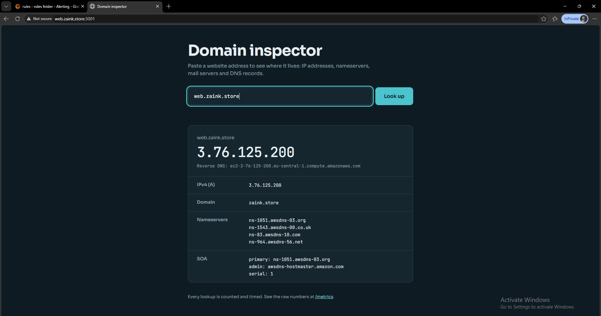
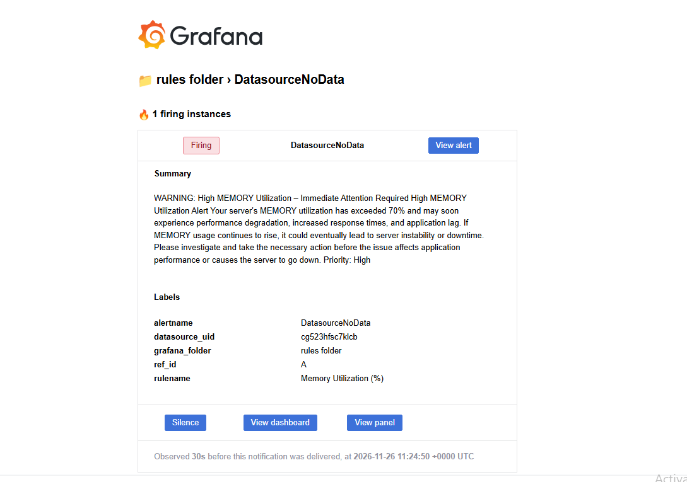
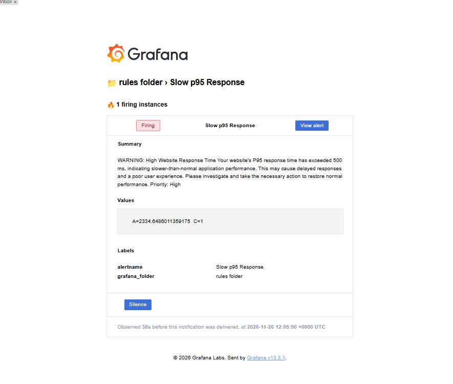
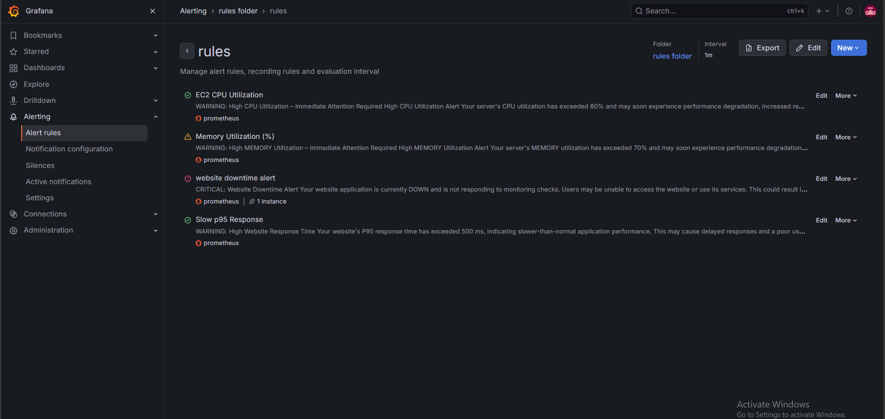

# AWS Server and Website Monitoring with Terraform, Prometheus and Grafana

A small but complete monitoring setup on AWS. It watches the health of a server and the uptime of a website, shows everything on live dashboards, and sends an email when something goes wrong.

The whole server is created with Terraform, so it can be rebuilt from code at any time.

## Architecture

.png>)

## What This Project Does

* **Builds the server with code:** Terraform creates the AWS EC2 server and opens only the ports the project needs: `22` (SSH), `80` (web), `3000` (Grafana), `3001` (web app), `9090` (Prometheus) and `9100` (Node Exporter).
* **Installs the tools with scripts:** Shell scripts install Prometheus, Node Exporter and Grafana, so there is no long manual setup.
* **Shows what is happening:** Node Exporter reads the server's CPU, memory and disk numbers. Prometheus collects and stores them. Grafana turns them into easy-to-read dashboards, so slowdowns can be spotted early.
* **Uses a real domain:** `web.zaink.store` points to the server's public IP using Amazon Route 53.

## The Website: Domain Inspector

The server also hosts a small web tool. Type in a domain name and it shows:

* IP addresses
* Nameservers
* Mail servers (MX records)
* Other DNS records

The tool is also what the monitoring watches. Every visit creates traffic, response times and status codes that appear on the dashboards.

## Screenshots

---

## Grafana Dashboards

There are two dashboards. One looks at the server itself, and the other looks at the website running on it. This makes it easier to tell where a problem starts: the machine or the app.

### 1. Web Server Dashboard

Shows how healthy the EC2 server is.

**What you can see:**

* **Basic info:** CPU cores, RAM and swap size, uptime, active network connections, and 5- and 15-minute load averages.
* **Live gauges:** Current CPU, memory and disk usage as percentages.
* **Trends over time:** CPU spikes, memory use, network traffic in and out, and disk read and write speed.

**Email alerts:**

* **High memory:** An email is sent if memory stays above **70%** for more than **1 minute**.
* **High CPU:** An email is sent if CPU stays above **90%** for more than **1 minute**.

---

### 2. Website Application Dashboard

Shows how the website is doing: is it up, how fast is it, and how much traffic is it getting.

**What you can see:**

* **Health and speed:** UP or DOWN status, uptime, requests per second, success and error rates, and response times (average and slowest 5%).
* **Traffic:** Request types (`GET`, `POST`, `PUT`, `DELETE`, `HEAD`), status codes (`200`, `404` and so on), and the busiest routes.
* **Node.js backend:** CPU use, memory and heap use, and event loop delay, which show whether the app stays responsive under load.

**Email alerts:**

* **Site down:** An email is sent if the website is down for more than **1 minute**.
* **Slow responses:** An email is sent if response time goes above **500ms** for more than **1 minute**.

---

## Tools Used

| Area | Tools |
| --- | --- |
| Infrastructure as code | Terraform |
| Cloud | AWS EC2, Amazon Route 53 |
| Monitoring | Prometheus, Node Exporter, Grafana |
| Web app | Node.js |
| Setup | Shell scripts |

## What I Plan to Add Next

* **HTTPS:** Put Nginx in front of the app and use free Let's Encrypt certificates, so traffic is encrypted.
* **Slack or Discord alerts:** Send alerts to a chat channel as well as email, so they are seen faster.
* **Docker Compose:** Run Prometheus, Grafana and the web app as containers, so the stack is easier to move and run anywhere.